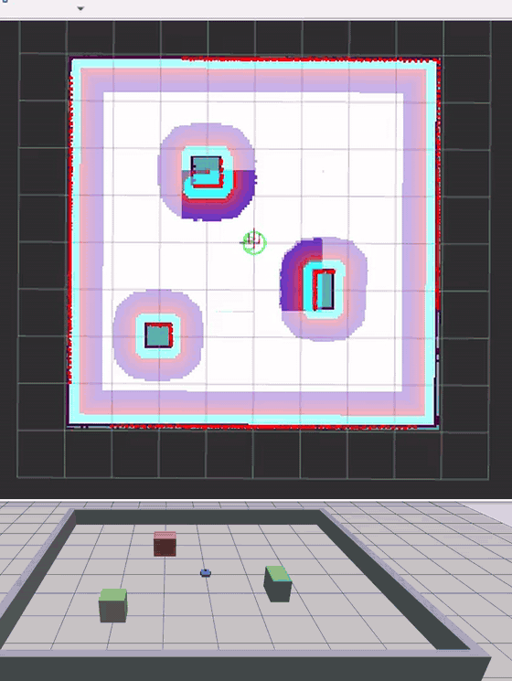

# Robot mobile autonome : ROS 2 Jazzy + Gazebo

Robot mobile à entraînement différentiel simulé : cartographie SLAM, localisation et navigation autonome avec Nav2, patrouille par points de passage, capteurs bruités et obstacle mobile.
*Simulated differential-drive robot: SLAM mapping, localization and autonomous navigation with Nav2, waypoint patrol, noisy sensors and a moving obstacle.*



## Fonctionnalités
- Description du robot en URDF/Xacro (châssis, 2 roues motrices, 2 roues folles, lidar 2D, IMU)
- Simulation Gazebo Harmonic : arène de 8 m x 8 m avec 3 obstacles fixes et 1 obstacle mobile, lidar 360° à 10 Hz
- Capteurs bruités : bruit gaussien de 1 cm sur le lidar, IMU à 50 Hz avec bruit gaussien (publiée sur `/imu`, pas encore fusionnée avec l'odométrie)
- Pont ROS 2 / Gazebo (`ros_gz_bridge`) : `/cmd_vel`, `/odom`, `/scan`, `/imu`, `/tf`, `/joint_states`, `/clock`, `/obstacle/cmd_vel`
- Cartographie avec `slam_toolbox`
- Localisation (AMCL) et navigation (Nav2, contrôleur MPPI)
- Patrouille autonome sur 5 points avec `nav2_simple_commander` et nouvelle tentative automatique après un échec

## Résultats
- Patrouille de 5 points bouclée en 46 s de temps simulé (environ 54 s en temps réel), sans échec
- Nav2 réglé pour un processeur modeste : contrôleur MPPI à 10 Hz avec 500 trajectoires, nouvelle tentative automatique après un échec
- Simulation à environ 86 % du temps réel sur un Intel Core i3-5005U (2 cœurs), 16 Go de RAM

## Simulation avancée
Les mêmes patrouilles avec des capteurs imparfaits, puis avec un obstacle mobile (0,3 m/s) qui traverse la trajectoire du robot :

| Configuration | Durée de la patrouille (temps simulé) | Échecs |
|---|---|---|
| Capteurs parfaits | 46,1 s (1 passage) | 0 |
| Lidar bruité (1 cm) | 46,6 s en moyenne (3 passages) | 0 |
| Lidar bruité + obstacle mobile | 47,9 s en moyenne (5 passages, de 46,2 s à 50,7 s) | 0 |

Échantillons réduits : ces mesures donnent un ordre de grandeur, pas une statistique.

## Prérequis
Ubuntu 24.04, ROS 2 Jazzy, Gazebo Harmonic.
```
sudo apt install ros-jazzy-desktop ros-jazzy-ros-gz ros-jazzy-navigation2 \
  ros-jazzy-nav2-bringup ros-jazzy-slam-toolbox ros-jazzy-xacro \
  ros-jazzy-teleop-twist-keyboard ros-jazzy-nav2-simple-commander
```

## Installation
```
git clone https://github.com/pekoemmanuel/robot-mobile-ros2.git ~/robot_ws
cd ~/robot_ws
colcon build --symlink-install
source install/setup.bash
```

## Utilisation
Simulation (Gazebo, pont ROS/Gazebo, robot) :
```
ros2 launch robot_gazebo sim.launch.py
```
Cartographie, dans un autre terminal, puis pilotage au clavier et sauvegarde de la carte :
```
ros2 launch slam_toolbox online_async_launch.py slam_params_file:=$HOME/robot_ws/src/robot_gazebo/config/slam_params.yaml use_sim_time:=true
ros2 run teleop_twist_keyboard teleop_twist_keyboard
ros2 run nav2_map_server map_saver_cli -f ~/robot_ws/src/robot_gazebo/maps/arene
```
Navigation autonome :
```
ros2 launch nav2_bringup bringup_launch.py map:=$HOME/robot_ws/src/robot_gazebo/maps/arene.yaml params_file:=$HOME/robot_ws/src/robot_gazebo/config/nav2_params.yaml use_sim_time:=true
ros2 run rviz2 rviz2 -d $(ros2 pkg prefix nav2_bringup)/share/nav2_bringup/rviz/nav2_default_view.rviz --ros-args -p use_sim_time:=true
```
Patrouille (après un 2D Pose Estimate au centre de l'arène) :
```
python3 scripts/patrouille.py --ros-args -p use_sim_time:=true
```
Obstacle mobile (dans un autre terminal, pendant la patrouille) :
```
python3 scripts/obstacle_mobile.py --ros-args -p use_sim_time:=true
```

## Structure du dépôt
- `src/robot_description` : modèle du robot (Xacro) et affichage RViz2
- `src/robot_gazebo` : monde, pont ROS/Gazebo, lancement, cartes, paramètres SLAM et Nav2
- `src/mon_premier_pkg` : premiers nœuds ROS 2 (publisher et subscriber)
- `scripts/patrouille.py` : patrouille par points de passage
- `scripts/obstacle_mobile.py` : pilotage de l'obstacle mobile
- `docs/` : démonstration (GIF)

## Pistes d'amélioration
- Fusion de l'IMU et de l'odométrie (`robot_localization`)
- Tests de limites : obstacle plus rapide, bruit plus important sur le lidar
- Essai sur un robot réel

## Auteur
Emmanuel PEKO, [LinkedIn](https://www.linkedin.com/in/pekoemmanuel)

## Licence
Apache-2.0
